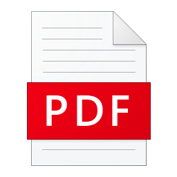
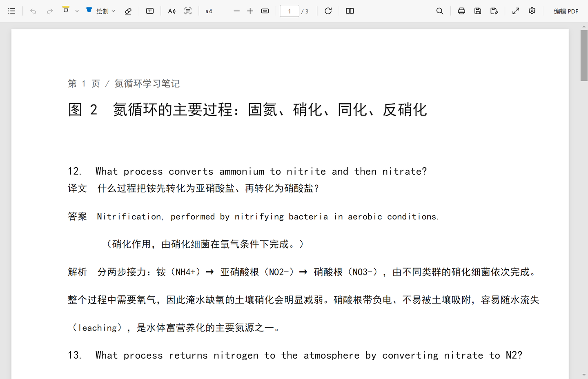
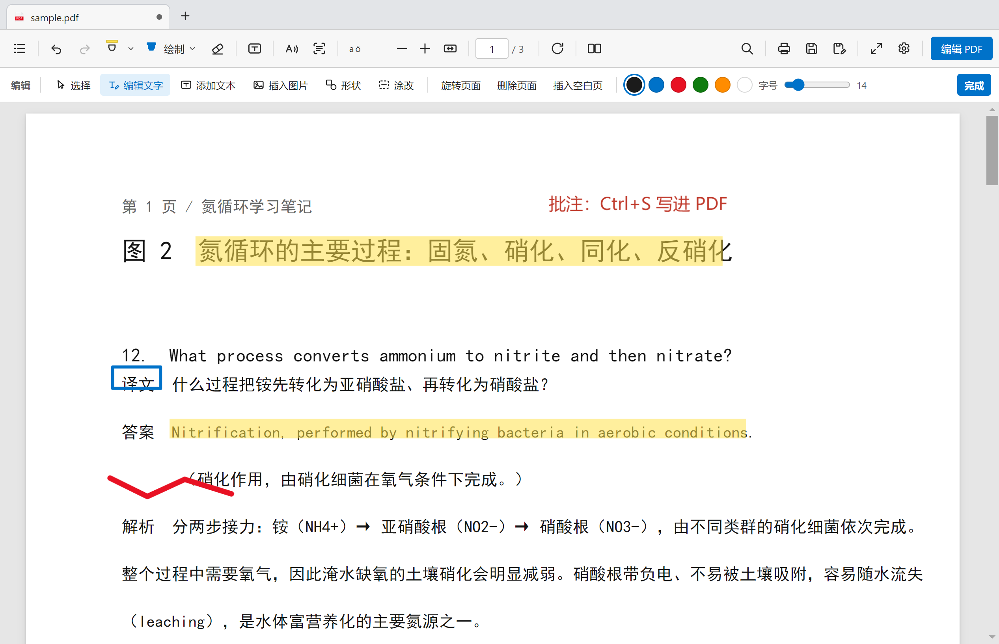
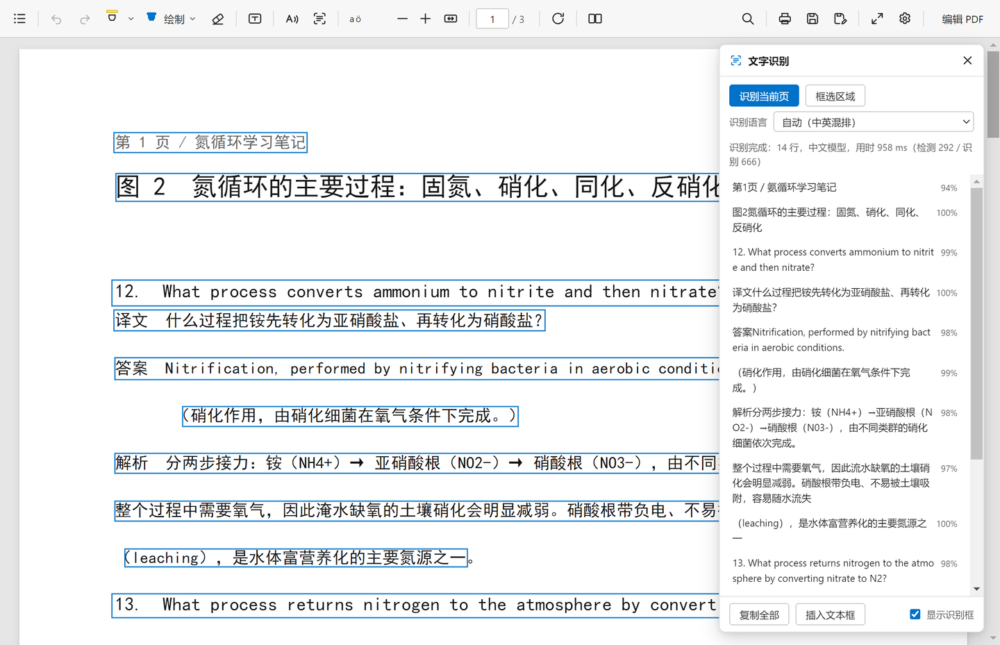
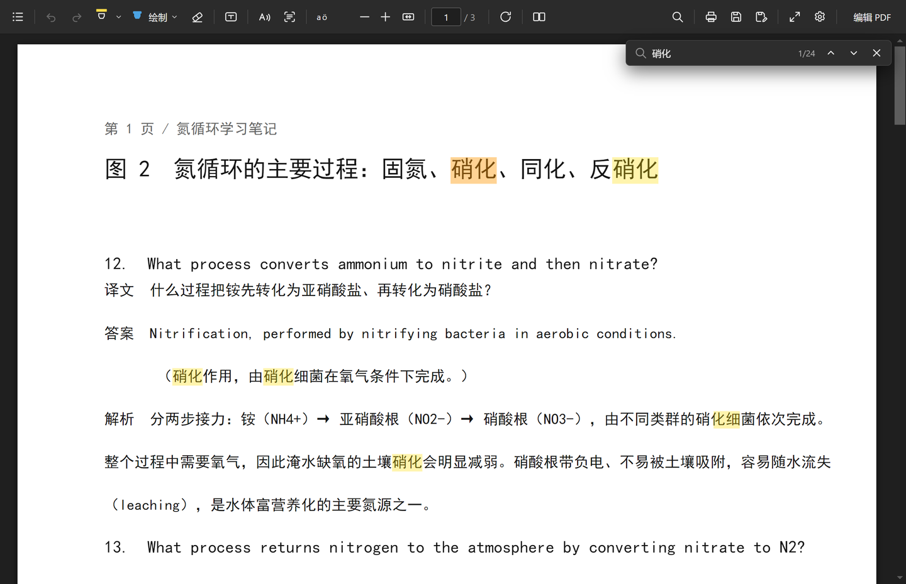
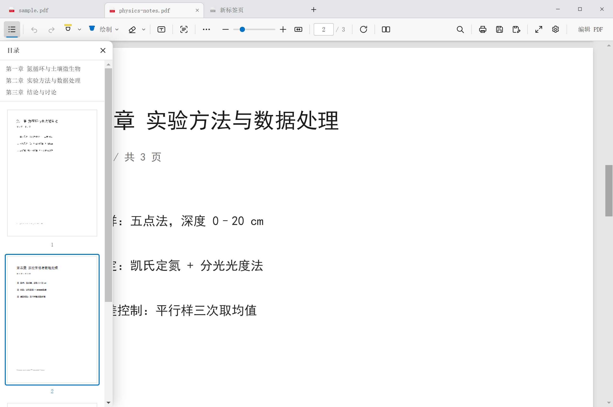
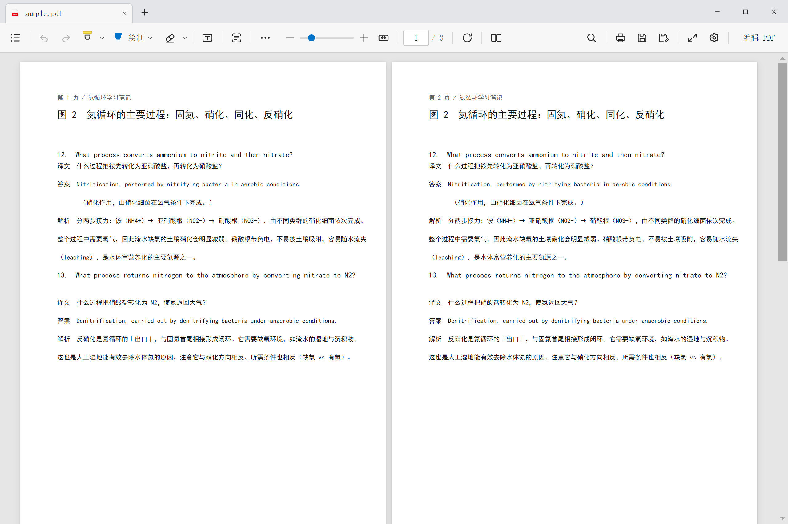
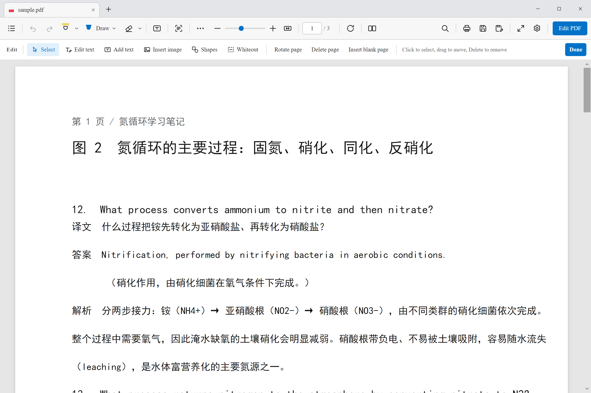
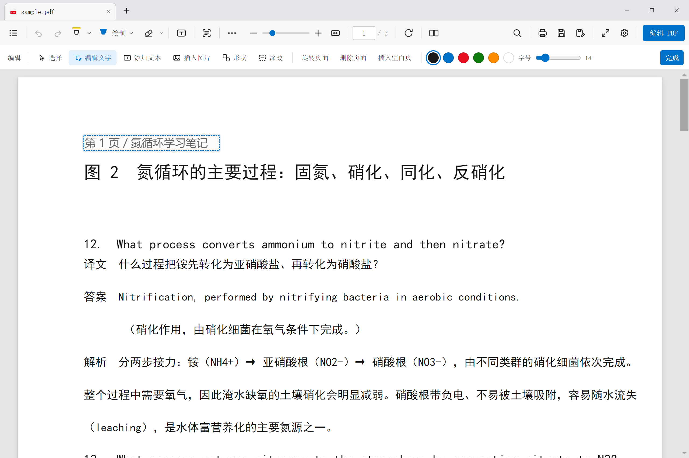
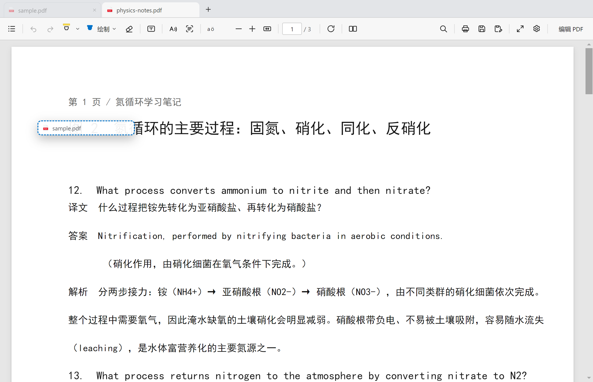

<div align="center">



# PDF Reader

**Clean UI · Serious features**

[English](README.md) · [简体中文](README.zh-CN.md)

A lightweight, fast PDF reader with **tabs**, annotation, in-place text editing, page management and
fully offline OCR — all inside a single, uncluttered window.

[](#install)
[](LICENSE)
[](https://www.electronjs.org/)
[](https://mozilla.github.io/pdf.js/)
[](#ocr)

</div>



## Why another PDF reader?

The options out there fall into two camps:

- **Browser built-ins**: clean and instant, but you cannot do anything beyond scribbling;
- **"All-in-one" PDF suites**: everything included — plus a start screen, membership pop-ups, sidebar
  recommendations, a cloud account, and a 500 MB download.

**This project argues you can have both**: one row of toolbar buttons you actually need, and none of the
features missing. No ads, no account, no network — it works offline, and even OCR runs locally.

## Highlights

| 🫧 Clean UI | 🧰 Serious features |
| --- | --- |
| One 48px toolbar row, no nested menu maze | Highlight / pen / eraser / text box / shapes / images / whiteout — all written back into the PDF |
| No start screen, no ads, no recommendations, no "upgrade to Pro" | Click the original text to **edit it in place** (no dialog), with automatic font subsetting |
| No account, no cloud sync, no network requests at all | Rotate / delete / insert pages, with the PDF genuinely rebuilt on save |
| Dark and light themes stay restrained and never fight the content | Home-grown **offline OCR**, automatic Chinese/English switching, scanned pages become selectable text |
| Opens instantly: one exe, no runtime to install | 20+ shortcuts, context menus, thumbnails, full-text search, printing |
| One-click Chinese/English UI (SimSun for Chinese, Times New Roman for English) | **Two-page view**, smooth Ctrl+wheel zoom, zoom slider |
| The tab strip is only 38px tall | **Browser-style tabs**: drag to reorder, tear out into a separate window, independent state |
| Sidebar appears on demand and takes no space otherwise | **Contents sidebar**: PDF bookmarks + page thumbnails, current page outlined |

## Screenshots

**Annotate and edit content** — read and fix in the same window:



**Offline OCR** — scanned documents become selectable, copyable and searchable:



**Full-text search / dark theme** — easy on the eyes at night:



**Tabs + contents sidebar** — keep the handout and the paper open, jump chapters from the outline:



**Two-page view** — compare two pages side by side:



**English UI** — switch language in Settings; English uses Times New Roman:



**In-place text editing** — click the original text and type; the dashed box is the edit area:



**Tear a tab out into its own window** — keep reading in a new window (dashed box marks the drop target):



## Features

### Reading

- Continuous scrolling, two-page view, fit width / fit page, 15%–500% zoom
- Page number jump, page rotation, full screen
- **Frameless title bar**: minimise / maximise / close share the tab row, drag the tab strip to move the
  window — not a single extra pixel
- **Tabs**: open several PDFs at once, drag to reorder, tear out into a separate window
  (see [interaction notes](docs/tabs-and-sidebar.md))
- **Contents sidebar**: `☰` in the top-left slides out PDF bookmarks (outline) and page thumbnails, with the
  current page outlined in blue. It **floats over the page** instead of shrinking it, so the document never
  reflows when it opens
- **Text selection and copy**: drag-select, double-click a word, `Ctrl+A`, right-click copy
- Full-text search: highlighted hits, orange marker on the current hit, previous/next, match counter
- Printing, document properties
- Open by drag & drop, by double-clicking a `.pdf`, single instance with multiple files
- Light / dark / follow-system themes

### Annotation (written into the PDF file)

| Tool | Notes |
| --- | --- |
| Highlight | Snaps to **text lines** while dragging instead of smearing into one block; 6 colours |
| Pen | 6 colours plus adjustable width, Bézier-smoothed |
| Eraser | **Round tip, radius 4–48px** (arrow next to the button); dragging erases only the ink under the dot and splits strokes into segments; other objects (highlight / text box / shape / image / whiteout) are removed as a whole when the dot lands on them |
| Text box | Type in place, double-click to edit again; **dashed box, drag to move, 8 handles to resize**, height follows the text |
| Shapes | Rectangle / ellipse / line / arrow |
| Insert image | PNG / JPG, scaled to the page |
| Whiteout | Drag a box to cover sensitive content |
| Undo / redo | 80-step snapshots covering both annotations and page operations |

### Content editing (really written back into the PDF)

- **Edit text**: click the original text with the "Edit text" tool and type. The reader samples the
  **colour and background** of the original glyphs, covers them precisely, re-typesets at the original
  size, and embeds a subset of a system font for Chinese (see [How it works](#how-it-works)).
- **Page management**: rotate, delete, insert blank pages; on save, pdf-lib rebuilds the page order and
  `/Rotate` entries.
- **Save / Save as**: only the edited parts change; the rest of the document (bookmarks, metadata, image
  streams) is preserved as-is.

### OCR

- **Whole page** or **selected region**
- **Chinese + English**: a Chinese model (6,623 characters, mixed Chinese/English) and an English model
  (95 characters, better with spaces and punctuation). The default "Auto" mode tries the Chinese model on
  the first few lines and switches to English when the page is purely English
- Boxes drawn over the page, line-by-line results, confidence scores, copy one line or everything
- **Insert as text boxes**: turn recognition results into an editable PDF text layer
- Fully offline: ONNX models with local CPU inference; no image ever leaves the machine

## Install

### Option 1: installer (recommended)

Download `PDFReader-Setup-x.y.z.exe` from [Releases](https://github.com/pinzhuo0905-rgb/pdf-reader/releases)
and run it ("install for me only" needs no administrator rights).

The installer is not code-signed, so SmartScreen may warn about an unknown publisher the first time:
*More info → Run anyway*.

After installing, **PDF Reader** shows up in the "Open with" list for `.pdf` files.

**Making it the default PDF reader** — two ways:

1. **Silent setup (recommended, no dialogs)** — no admin rights needed, pure registry work:

   ```powershell
   powershell -ExecutionPolicy Bypass -File scripts\set-default-pdf.ps1
   ```

   The script registers the app as the `.pdf` handler, adds it to the "Open with" list and removes the
   hash-protected `UserChoice` entry Windows keeps (your previous choice is backed up to
   `%APPDATA%\pdf-reader\assoc-backup.json`; pass `-Restore` to roll back).

2. Right-click any PDF → Open with → Choose another app → **PDF Reader**, or use the menu
   `⋯ → Set as default PDF reader`.

### Option 2: run from source

```bash
git clone https://github.com/pinzhuo0905-rgb/pdf-reader.git
cd pdf-reader
npm install      # also runs scripts/prepare-vendor.mjs
npm start        # development mode
npm run dist     # build the installer into dist/
```

Requires Node.js ≥ 18. The first build downloads Electron and the NSIS toolchain (about 200 MB).

## Usage

### Keyboard shortcuts

| Shortcut | Action | Shortcut | Action |
| --- | --- | --- | --- |
| `Ctrl+O` | Open file | `Ctrl+S` | Save |
| `Ctrl+Shift+S` | Save as | `Ctrl+P` | Print |
| `Ctrl+F` | Search | `Ctrl+C` / `Ctrl+A` | Copy / select all text |
| `Ctrl+Z` / `Ctrl+Y` | Undo / redo | `Ctrl+ +` / `Ctrl+-` | Zoom in / out |
| `Ctrl+0` | Fit page | `F11` | Full screen |
| `PgUp` / `PgDn` | Previous / next page | `Delete` | Delete selected annotation |
| `H` | Highlight | `D` | Draw |
| `E` | Eraser | `T` | Text box |
| `R` | Rotate page | `V` | Select tool |
| `Ctrl+T` | New tab | `Ctrl+W` | Close tab |
| `Ctrl+Tab` | Next tab | `Ctrl+Shift+Tab` | Previous tab |
| `Esc` | Leave the current tool / close a panel | | |

### Tabs and contents

| Action | Result |
| --- | --- |
| `+` / `Ctrl+T` | New empty tab (pick a file right from the empty state) |
| Open a second PDF | A new tab is created; **re-opening the same file switches back to its existing tab** |
| Drag a tab | Move it left/right within the strip to reorder |
| Drag a tab onto the page area and release | The document opens in a new window and the tab closes |
| Middle click / `Ctrl+W` / the × on a tab | Close the tab (asks first if there are unsaved changes) |
| Right-click a tab | Close others / close to the right / copy path / show in folder / open in new window |
| `☰` in the top-left | Show or hide the contents sidebar (bookmarks + thumbnails) |

Each tab keeps its own page number, zoom, tool, annotations, undo stack, search results and OCR results,
so switching back restores everything. See [docs/tabs-and-sidebar.md](docs/tabs-and-sidebar.md) for the
full interaction flow.

### Two notes on editing text

1. This project uses **"cover and retype"** rather than rewriting the original text stream. That is the
   usual approach for lightweight PDF editors: reliable and non-destructive to the rest of the document,
   at the cost of the replaced text no longer being recoverable.
2. Scanned (image-only) PDFs have no text layer. Use **OCR → Insert as text boxes**, or whiteout plus a
   text box.

### Using OCR

1. Click the text-recognition icon in the toolbar (or `⋯ → Text recognition`);
2. Choose "Recognize page" or "Select region";
3. Leave the language on "Auto", or pick "Chinese + English" / "English only";
4. When it finishes you can copy everything, click a line to jump to it, or "Insert as text box" to write
   the results into the PDF.

## How it works

```
┌──────────────────────────── main process (Node) ──────────────────────┐
│  windows/menus/IPC   app:// protocol   file IO   printing   OCR engine  │
│                                                    ├ image.js  geometry │
│                                                    ├ det.js    DB post  │
│                                                    ├ rec.js    CTC decode│
│                                                    └ index.js  pipeline  │
└───────────────────────────────┬───────────────────────────────────────┘
                                │ contextBridge (restricted API)
┌───────────────────────────────┴───────────────────────────────────────┐
│  renderer (plain DOM, no framework, no bundler)                        │
│  viewer.js render/zoom/text layer/search   annotate.js   textedit.js   │
│  exporter.js pdf-lib write-back            ocr.js panel  ui.js         │
└───────────────────────────────────────────────────────────────────────┘
```

- **Rendering**: PDF.js 3.11 renders pages lazily; an `IntersectionObserver` drives visible pages and
  canvases far from the viewport are released.
- **Text layer**: absolutely positioned transparent `span`s are generated from PDF text items and then
  re-measured with `scaleX` to match the original layout, so drag-select, copy and double-click-to-select
  are native browser behaviour.
- **Annotations**: coordinates are normalised to the page (0–1) and mapped through the `/Rotate`
  quadrants on export, so rotated pages never drift.
- **Text editing**: sample the glyph colour and background from the page canvas → cover with a rectangle →
  re-typeset at the original size → embed a Chinese font subset.
- **OCR**: DB text detection (differentiable binarisation) + CRNN/SVTR + greedy CTC decoding. **All
  preprocessing, post-processing and decoding is JavaScript written in this repository**; only
  `onnxruntime-node` is used as a generic tensor runtime. See
  [docs/ocr-research.md](docs/ocr-research.md) for the details and measurements.

### Replacing the application icon

The default icon shipped with the project is described in [THIRD-PARTY-NOTICES.md](THIRD-PARTY-NOTICES.md).
To use your own:

1. Put a PNG of at least 256×256 at `build/icon.png`;
2. Point `build.win.icon`, `nsis.installerIcon` and friends in `package.json` at that PNG
   (electron-builder converts it to ICO automatically);
3. Replace `assets/pdf-icon.ico` (the file-association icon) as well.

## Known limitations

- Text editing is "cover and retype"; the original text stream is untouched. Encrypted PDFs are not
  supported (there is no password prompt).
- Interactive forms (AcroForm) cannot be filled in yet.
- OCR occasionally confuses similar-looking glyphs at very small sizes (<10px), and spaces in dense
  layouts may be merged.
- Tearing out a tab **re-opens the file from disk**; unsaved annotations do not come along (tearing out is
  blocked while there are unsaved changes).
- Tabs are not remembered when the window closes; the next launch starts with a blank tab.
- Only a Windows x64 installer is published; Linux / macOS users need to run `npm run dist` themselves
  (the core code is cross-platform).
- Printing renders pages to images first rather than emitting vectors; documents with mixed page sizes are
  laid out using the first page's size.
- There is no PDF annotation layer, and in-document links and form widgets are not interactive (use a
  dedicated tool for forms).
- Saved annotations are graphics drawn onto the page content, not standard PDF annotation objects, so other
  readers cannot select or delete them individually.

## Roadmap

- [x] Tabs + contents sidebar (v1.1)
- [ ] Form filling and signatures
- [ ] Export comments as standard PDF annotations
- [ ] Drag to reorder / extract pages
- [ ] Session restore (reopen last session's tabs)
- [ ] macOS / Linux builds

## Contributing

Issues and pull requests are welcome — please read [CONTRIBUTING.md](CONTRIBUTING.md) first. Especially
welcome:

- New OCR language models (Japanese / Korean / Russian …)
- More annotation types (squiggly, strikethrough, sticky notes)
- Performance work (very large documents, extremely long text lines)

## License

[MIT](LICENSE). Third-party components and assets are listed in
[THIRD-PARTY-NOTICES.md](THIRD-PARTY-NOTICES.md).
