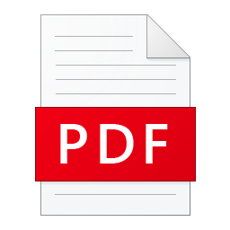
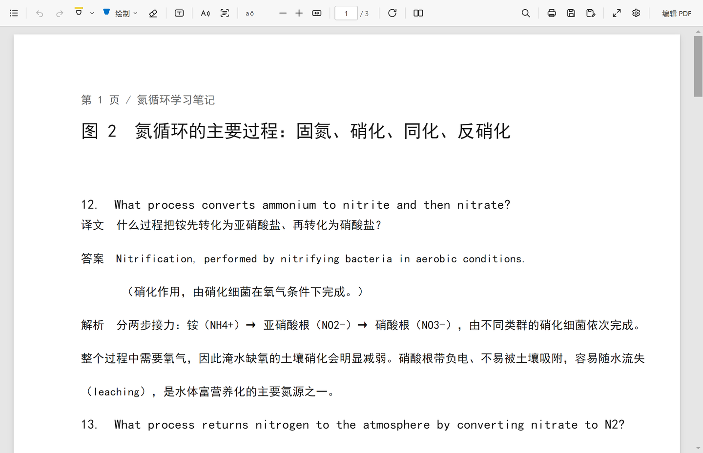
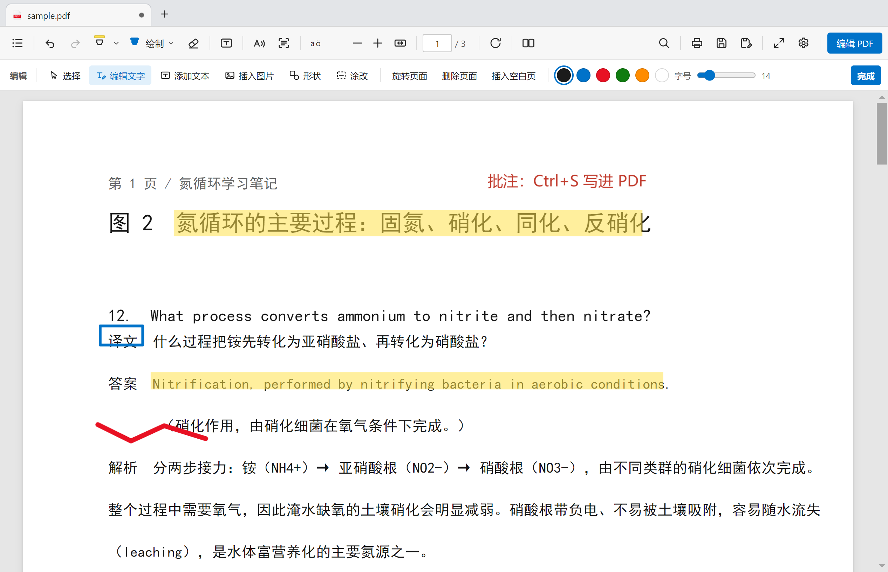
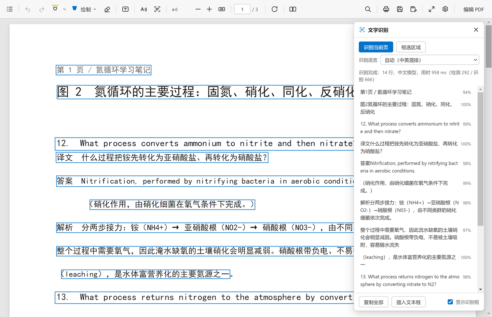
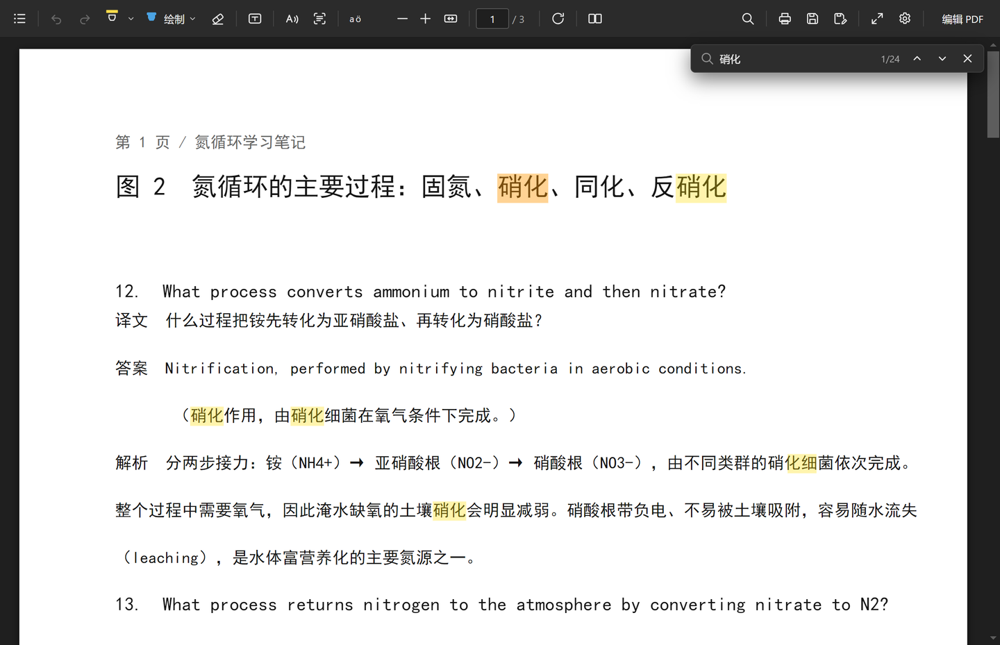
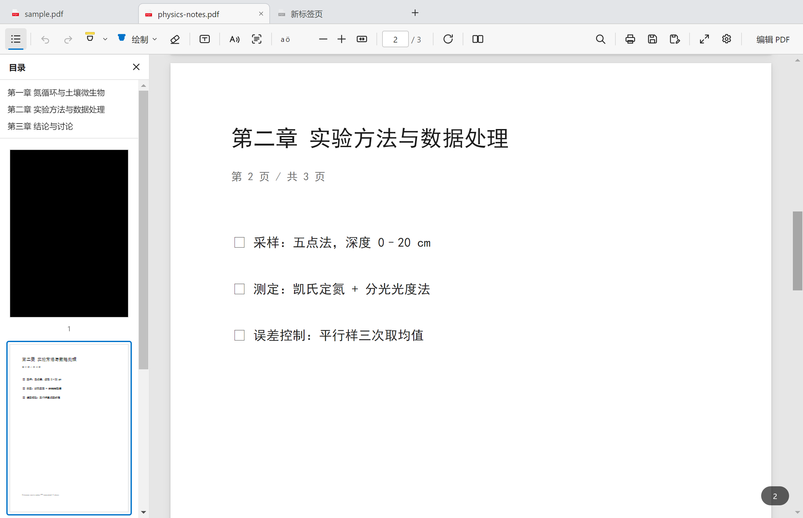
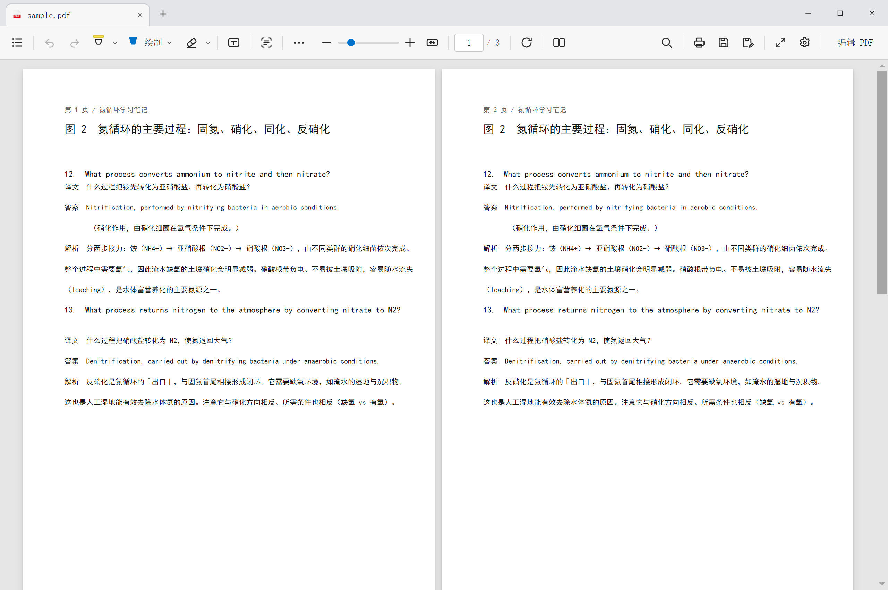
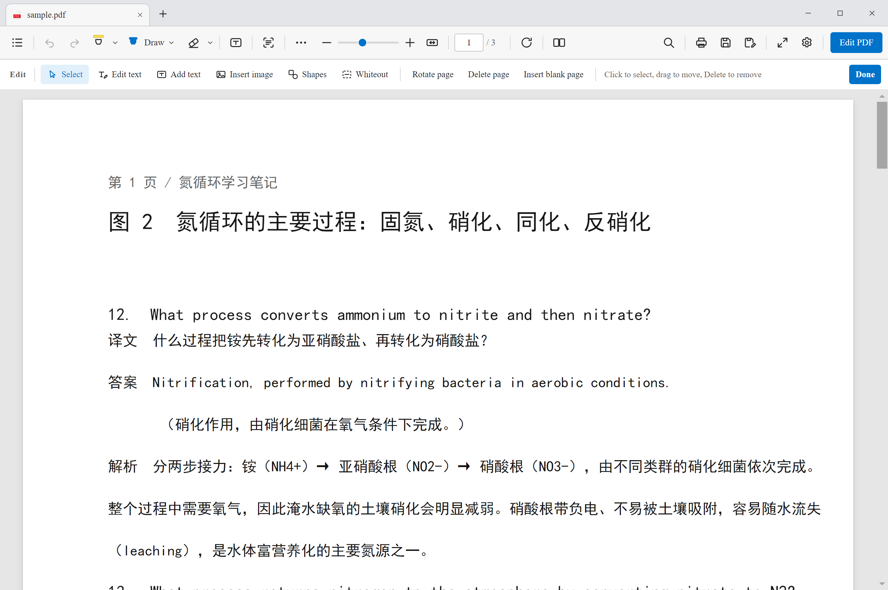
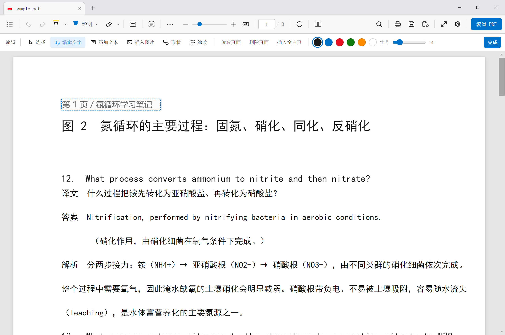
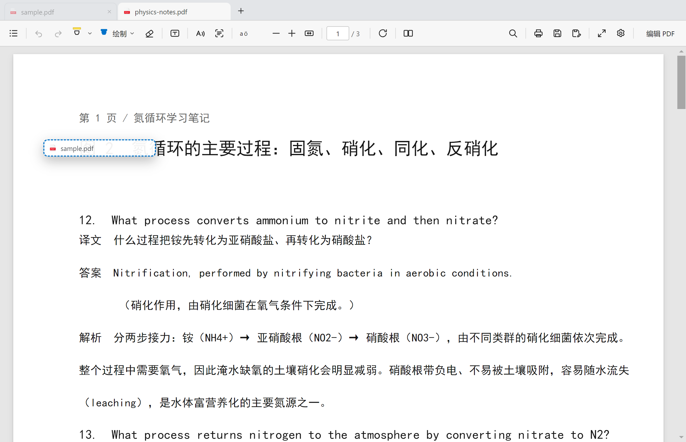

<div align="center">



# PDF Reader

[English](README.md) · **简体中文**

**界面纯净 · 功能丰富**

一个轻快的 PDF 阅读器：界面只留一层工具栏，却把**多标签页**、标注、改字、页面管理、离线 OCR 全都装了进去。

[](#安装)
[](LICENSE)
[](https://www.electronjs.org/)
[](https://mozilla.github.io/pdf.js/)
[](#ocr-文字识别)

</div>



## 为什么又造一个 PDF 阅读器？

市面上的选择基本分两类：

- **浏览器内置阅读器**：界面干净、打开即读，但除了画两笔什么都做不了；
- **「全能」PDF 工具**：功能一堆，代价是启动页、会员弹窗、右侧推荐、云同步账号，以及动辄 500 MB 的体积。

**这个项目想证明两件事可以同时成立**：界面只保留你真正需要的那一层工具栏，而功能一个都不少。
零广告、零账号、零联网——断网也能用，OCR 也在本地跑。

## 核心卖点

| 🫧 界面纯净 | 🧰 功能丰富 |
| --- | --- |
| 一层 48px 工具栏，没有二级菜单迷宫 | 高亮 / 画笔 / 橡皮 / 文本框 / 形状 / 图片 / 涂改，全部能写回 PDF |
| 无启动页、无广告、无推荐、无「升级 Pro」 | 点击原文即可**原地改字**（不弹框，直接写在页面上），中文字体子集自动嵌入 |
| 无账号、无云同步、无任何网络请求 | 页面旋转 / 删除 / 插入，保存时真正重排 PDF |
| 深色 / 浅色主题都保持克制，不抢内容 | 自研 **离线 OCR**，中英双语自动切换，扫描页变可复制文本 |
| 打开即读：一个 exe，不装运行库 | 20+ 快捷键、右键菜单、缩略图、全文搜索、打印 |
| 中英双语界面一键切换（中文宋体 / 英文 Times New Roman） | **双页视图**、Ctrl+滚轮平滑缩放、缩放滑块 |
| 标签条只有 38px，不挤占阅读区 | **浏览器式多标签页**：拖拽排序、拖出成独立窗口、状态各自独立 |
| 侧栏按需展开，默认不占地方 | **目录侧栏**：PDF 书签 + 页面缩略图，当前页高亮 |

## 截图

**标注与内容编辑** —— 同一个界面里，读完就能改：



**离线 OCR** —— 扫描件也能选中、复制、搜索：



**全文搜索 / 深色主题** —— 夜里读论文不刺眼：



**多标签页 + 目录侧栏** —— 同时开着讲义和论文，左侧点书签直接跳章：



**双页视图** —— 讲义对照排版时一屏看两页：



**English UI** —— 设置里切换语言，英文界面用 Times New Roman：



**页内原地编辑** —— 点原文直接在页面上改，虚线框即编辑区：



**把标签页拖出成独立窗口** —— 松手即在新窗口继续读（虚线框为落点提示）：



## 功能列表

### 阅读

- 连续滚动、双页视图、适应宽度 / 适应页面、15%–500% 缩放
- 页码跳转、旋转页面、全屏
- **无边框标题栏**：最小化 / 最大化 / 关闭与标签同一行，拖动标签条即可移动窗口，不多占一像素
- **多标签页**：同时打开多个 PDF，标签可拖拽排序、可拖出为独立窗口（见[交互说明](docs/tabs-and-sidebar.md)）
- **目录侧栏**：左上角 `☰` 展开，含 PDF 书签（大纲）与页面缩略图，当前页蓝色描边
- **文本选择与复制**：拖选、双击选词、`Ctrl+A` 全选、右键复制
- 全文搜索：命中高亮、当前命中橙色标记、上一个 / 下一个、命中计数
- 打印、文档属性
- 拖放打开、`.pdf` 双击打开、单实例多文件切换
- 浅色 / 深色 / 跟随系统主题

### 标注（写入 PDF 文件）

| 工具 | 说明 |
| --- | --- |
| 高亮 | 拖动时按**文字行吸附**，不会糊成一整块；6 种颜色 |
| 画笔 | 6 种颜色 + 粗细可调，贝塞尔平滑 |
| 橡皮擦 | **圆形笔尖，半径 4–48px 可调**（按钮右侧箭头）；按住拖动只擦掉圆点下方的涂鸦，笔画会断成多段；其它对象（高亮/文本框/形状/图片/涂改）圆点落上去时整体删除 |
| 文本框 | 就地输入，双击可再次编辑；**虚线框，拖动移动、拖 8 个手柄缩放**，框高自动跟随文字 |
| 形状 | 矩形 / 椭圆 / 直线 / 箭头 |
| 插入图片 | PNG / JPG，自动适配页面比例 |
| 涂改遮盖 | 拖框覆盖，用于遮盖敏感信息 |
| 撤销 / 重做 | 80 步快照，覆盖标注与页面操作 |

### 内容编辑（真正写回 PDF）

- **改字**：用「编辑文字」点一下原文 → 就地修改。原理是采样原文字的**颜色与底色**，
  先精确遮盖再按原字号重排，中文用系统字体子集嵌入（见 [技术实现](#技术实现)）。
- **页面管理**：旋转、删除、插入空白页；保存时用 pdf-lib 重建页面顺序与 `/Rotate`。
- **保存 / 另存为**：只改动被编辑的部分，文档其余结构（书签、元数据、图片流）原样保留。

### OCR 文字识别

- **整页识别** 或 **框选区域识别**
- **中英双语**：中文模型（6623 字，中英混排）+ 英文模型（95 字符，空格标点更准），
  默认「自动」——先用中文模型试识别前几行，判断为纯英文时自动切换
- 识别框叠加显示、按行列出、置信度、复制单行 / 全文
- **插入为文本框**：把识别结果变成可编辑的 PDF 文本层
- 完全离线：ONNX 模型 + 本地 CPU 推理，不上传任何图像

## 安装

### 方式一：安装包（推荐）

到 [Releases](https://github.com/pinzhuo0905-rgb/pdf-reader/releases) 下载 `PDFReader-Setup-x.y.z.exe`，
双击安装（「仅为我安装」不需要管理员权限）。

安装包未做代码签名，首次运行 Windows SmartScreen 可能提示「未知发布者」→ 更多信息 → 仍要运行。

安装后 `.pdf` 文件即可在「打开方式」中选择本程序。

**设为默认 PDF 阅读器**有两种方式：

1. **静默设置（推荐，全程无弹窗）**——普通权限即可，纯注册表操作：

   ```powershell
   powershell -ExecutionPolicy Bypass -File scripts\set-default-pdf.ps1
   ```

   脚本会把本程序注册为 `.pdf` 的处理程序、写入「打开方式」列表，并清掉系统里那条
   被哈希保护的 `UserChoice`（原选择会备份到 `%APPDATA%\pdf-reader\assoc-backup.json`，
   加 `-Restore` 可还原）。

2. 右键任意 PDF → 打开方式 → 选择其他应用 → **PDF Reader**，或菜单 `⋯ → 设为默认 PDF 阅读器`。

### 方式二：从源码运行

```bash
git clone https://github.com/pinzhuo0905-rgb/pdf-reader.git
cd pdf-reader
npm install      # 自动执行 scripts/prepare-vendor.mjs
npm start        # 开发模式
npm run dist     # 打包安装包到 dist/
```

需要 Node.js ≥ 18。首次打包会下载 Electron 与 NSIS 工具链（约 200 MB）。

## 使用

### 快捷键

| 快捷键 | 功能 | 快捷键 | 功能 |
| --- | --- | --- | --- |
| `Ctrl+O` | 打开文件 | `Ctrl+S` | 保存 |
| `Ctrl+Shift+S` | 另存为 | `Ctrl+P` | 打印 |
| `Ctrl+F` | 搜索 | `Ctrl+C` / `Ctrl+A` | 复制 / 全选文本 |
| `Ctrl+Z` / `Ctrl+Y` | 撤销 / 重做 | `Ctrl+ +` / `Ctrl+-` | 放大 / 缩小 |
| `Ctrl+0` | 适应页面 | `F11` | 全屏 |
| `PgUp` / `PgDn` | 上一页 / 下一页 | `Delete` | 删除选中标注 |
| `H` | 高亮 | `D` | 绘制 |
| `E` | 橡皮擦 | `T` | 文本框 |
| `R` | 旋转页面 | `V` | 选择工具 |
| `Ctrl+T` | 新建标签页 | `Ctrl+W` | 关闭标签页 |
| `Ctrl+Tab` | 下一个标签页 | `Ctrl+Shift+Tab` | 上一个标签页 |
| `Esc` | 退出当前工具 / 关闭面板 | | |

### 多标签页与目录

| 操作 | 结果 |
| --- | --- |
| `+` / `Ctrl+T` | 新开一个空白标签页（空状态页里可直接选文件） |
| 打开第二个 PDF | 自动新建标签页；**同一文件重复打开会切回已有标签页** |
| 拖动标签 | 在标签条内左右拖动 → 调整顺序 |
| 把标签拖到页面区域松手 | 该文档在新窗口打开，原窗口的标签页关闭 |
| 中键 / `Ctrl+W` / 标签上的 × | 关闭标签页（有未保存修改会先询问） |
| 标签上右键 | 关闭其他 / 关闭右侧 / 复制路径 / 在文件夹中显示 / 在新窗口打开 |
| 左上角 `☰` | 展开或收起「目录」侧栏（书签 + 缩略图） |

每个标签页的页码、缩放、工具、标注、撤销栈、搜索结果、OCR 结果都是**各自独立**的，
切回来还是原样。详细交互流程与界面元素见 [docs/tabs-and-sidebar.md](docs/tabs-and-sidebar.md)。

### 改字的两点说明

1. 本项目采用**「遮盖 + 重写」**而不是直接改写原文字流。这是轻量级 PDF 编辑器的通用做法：
   可靠、不破坏原文档，代价是被改的原文字无法再被"还原"。
2. 扫描件（图片型 PDF）没有文字层，请先用 **OCR → 插入文本框**，或直接用涂改 + 文本框覆盖。

### OCR 用法

1. 工具栏点「文字识别」图标（或 `⋯ → 文字识别`）；
2. 选择「识别当前页」或「框选区域」；
3. 语言默认「自动」，也可手动指定「中文 + 英文」/「纯英文」；
4. 识别完成后可复制全文、点行跳转，或「插入文本框」把结果写进 PDF。

## 技术实现

```
┌──────────────────────────── 主进程 (Node) ────────────────────────────┐
│  窗口/菜单/IPC   app:// 自定义协议   文件读写   打印    OCR 引擎        │
│                                                    ├ image.js  几何变换  │
│                                                    ├ det.js    DB 后处理 │
│                                                    ├ rec.js    CTC 解码  │
│                                                    └ index.js  管线/语种  │
└───────────────────────────────┬───────────────────────────────────────┘
                                │ contextBridge（受限 API）
┌───────────────────────────────┴───────────────────────────────────────┐
│  渲染进程（原生 DOM，零框架、零打包）                                   │
│  viewer.js 渲染/缩放/文本层/搜索   annotate.js 标注   textedit.js 改字  │
│  exporter.js pdf-lib 写回          ocr.js 面板        ui.js 工具栏/快捷键│
└───────────────────────────────────────────────────────────────────────┘
```

- **渲染**：PDF.js 3.11 逐页懒渲染，`IntersectionObserver` 控制可见页，远离视口的画布自动释放；
- **文本层**：按 PDF 文本项生成绝对定位的透明 `span`，二次测量做 `scaleX` 对齐原排版，
  因此拖选、复制、双击选词都是浏览器原生行为；
- **标注**：屏幕坐标统一归一化到页面（0–1），导出时按 `/Rotate` 做四象限坐标变换，保证旋转页不错位；
- **改字**：从页面画布采样原文字色与底色 → 白色/底色矩形遮盖 → 按原字号重排 → 中文字体子集嵌入；
- **OCR**：DB 文本检测（可微二值化）+ CRNN/SVTR + CTC 贪心解码，**全部预处理/后处理/解码都是本仓库自己写的 JS**，
  只有 `onnxruntime-node` 作为通用张量运行时；详细原理与实测见 [docs/ocr-research.md](docs/ocr-research.md)。

### 替换应用图标

项目自带默认图标的来源见 [THIRD-PARTY-NOTICES.md](THIRD-PARTY-NOTICES.md)。
若要换成自己的图标：

1. 准备一张 ≥ 256×256 的 PNG，放到 `build/icon.png`；
2. 把 `package.json` 里 `build.win.icon`、`nsis.installerIcon` 等指向该 PNG（electron-builder 会自动转 ICO）；
3. 同步替换 `assets/pdf-icon.ico`（文件关联图标）。

## 已知限制

- 文字编辑是「遮盖 + 重写」，不改写原文字流；加密 PDF 暂不支持（不会提示输入密码）
- 交互式表单（AcroForm）暂不支持填写
- OCR 对极小字号（<10px）的形近字偶有混淆，密集排版的空格可能被合并
- 拖出标签页时会**重新从磁盘打开**该文件，未保存的标注不会跟着走（有未保存修改时不允许拖出）
- 关闭窗口前不会记住标签页，下次启动是空白标签页
- 目前只提供 Windows x64 安装包，Linux / macOS 需自行 `npm run dist`（核心代码跨平台）
- 打印走的是「页面渲染成图 → 打印」，不是矢量输出；混合页面尺寸的文档会统一按第一页尺寸排版
- 没有 PDF 注释层，文档内的超链接与表单控件不可交互（表单请用专用工具填写）
- 保存后的标注是「画在页面内容上」的图形，不是标准 PDF 注释对象，其他阅读器里不能单独选中/删除

## 路线图

- [x] 多标签页 + 目录侧栏（v1.1）
- [ ] 表单填写与签名
- [ ] 批注（Comment）导出为标准 PDF 注释对象
- [ ] 页面拖拽排序 / 提取
- [ ] 会话恢复（重启后恢复上次的标签页）
- [ ] macOS / Linux 构建

## 贡献

欢迎 Issue 与 PR，请先读 [CONTRIBUTING.md](CONTRIBUTING.md)。特别欢迎：

- 新的 OCR 语种模型接入（日 / 韩 / 俄…）
- 标注类型扩展（波浪线、删除线、便签）
- 性能优化（大文档、超长文本行）

## 许可证

[MIT](LICENSE)。第三方组件与资源的许可见 [THIRD-PARTY-NOTICES.md](THIRD-PARTY-NOTICES.md)。
