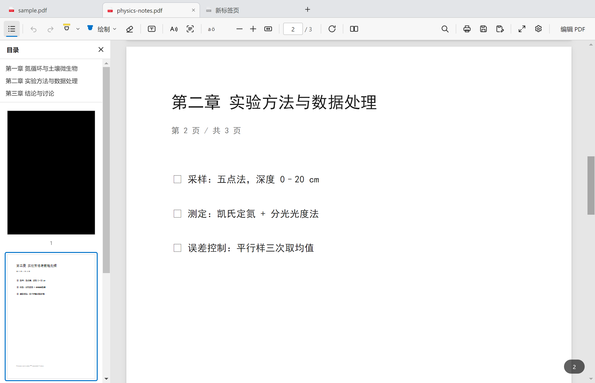

# v1.1.0 —— 多标签页与目录侧栏

> 界面还是那一层，能装的东西更多了。

## 新增：浏览器式多标签页

同时打开多个 PDF，顶部一条 38px 的标签条，行为向浏览器看齐：

- **标签**：左侧统一使用 PDF 文件图标（空白标签页为灰度），标题是文件名，过长自动省略；
- **打开即新建**：打开第二个文件自动新建标签页；**同一个文件重复打开会切回已有标签页**，不会开出一堆重复页；
- **拖拽排序**：在标签条内左右拖动，落点有 2px 蓝色竖线提示；
- **拖出成独立窗口**：把标签拖到页面区域松手，该文档在新窗口打开（位置跟随鼠标），原标签页关闭。
  拖拽中标签浮影会带蓝色虚线描边表示"松手即开新窗口"；
- **关闭**：`×` / 中键 / `Ctrl+W`；有未保存修改时 `×` 变成小圆点，关闭前会询问保存；
  右键菜单支持关闭其他 / 关闭右侧 / 复制路径 / 在文件夹中显示 / 在新窗口打开；
- **状态完全独立**：每个标签页各自持有页码、缩放、当前工具、标注、撤销栈、搜索结果、OCR 结果；
- **快捷键**：`Ctrl+T` 新建、`Ctrl+W` 关闭、`Ctrl+Tab` / `Ctrl+Shift+Tab` 切换。



## 新增：目录侧栏

左上角 `☰` 现在展开/收起「目录」侧栏（原来藏在这个按钮里的菜单项已并入工具栏右侧的 `⋯`）：

- **书签区**：读取 PDF 自带的 `/Outlines`，按层级缩进，点击直接跳章；
- **缩略图区**：每页一张缩略图，页码在下方，当前页 2px 蓝色描边，滚动时高亮自动跟随并居中；
- 默认收起，展开宽度 236px，不影响"适应宽度"的计算。

## 改进

- **切换标签页不再闪白**：切回某个标签页时保留已有画布，只在窗口宽度变化时重算缩放；
- 同一页的渲染改为**串行排队**，避免并发绘制同一画布导致的偶发白页；
- 新增兜底巡检：可见页若因异常中断没画出来，会在 1.5s 内自动补绘；
- 窗口支持多实例共存：每个窗口独立维护自己的标签页与关闭确认；
- 再次双击 `.pdf` 或从资源管理器拖入文件，都会作为新标签页加入现有窗口。

## 自检

新增 `npm run test:tabs`，覆盖 16 项断言（全部通过）：

```
secondTabOpened ok · activeIsSecond ok · tabIcon ok · dedupeByPath ok
sidebarOpen ok · sidebarTitle ok · thumbs ok · outline ok · outlineJump ok
dropHint ok · reorder ok · zoomIsolation ok
detachGhost ok · detachRemovedTab ok · noGhostLeft ok · blankTabAfterCloseAll ok
```

原有 `npm run test:interact`（文本选择、高亮、画笔、橡皮、撤销、旋转）与 `npm run test:ocr`
（整页 14 行 + 区域 4 行 + 导出 PDF）回归通过。

## 安装

下载 `PDFReader-Setup-1.1.0.exe`，双击安装（"仅为我安装"不需要管理员权限）。
安装包未签名，SmartScreen 提示"未知发布者"时选"更多信息 → 仍要运行"。

覆盖安装会保留原有设置（主题、OCR 语言、上次打开目录）。

## 已知限制

- 拖出标签页时是**重新从磁盘打开**该文件，未保存的标注不会跟着走（有未保存修改时不允许拖出）；
- 关闭窗口不记忆标签页，下次启动仍是空白页（会话恢复在路线图里）；
- 目录侧栏的书签区依赖 PDF 自身带大纲，扫描件通常没有。
