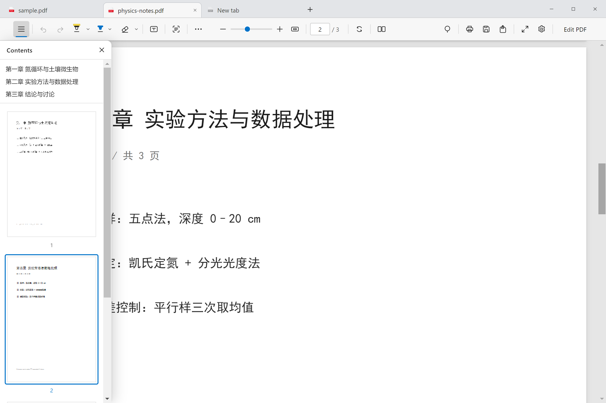

# Tabs and the contents sidebar

Two pieces of UI are described here: the **tab strip** at the top (browser-style tabs that can be torn
out into their own window) and the **contents sidebar** opened by the `☰` button in the top-left corner.



---

## 1. Window layout

Four layers, and the reading area is always the largest one:

| Layer | Height | Contents | Notes |
| --- | --- | --- | --- |
| ① Tab strip `#tabbar` | 38px | Tabs + `+` + window buttons | Also the title bar (frameless window): drag empty space to move, double-click to maximise |
| ② Toolbar `#toolbar` | 48px | One single row with every tool | Does not change with the number of tabs |
| ③ Content `#main` | flexible | Page area (the sidebar is an overlay) | Sidebar is closed by default; when open it floats 236px above the page |
| ④ Overlays | — | Search bar, OCR panel, dialogs, drag ghost | Never participate in layout |

### Tabs

```
┌─────────────────────────────────────────────┐
│ ▢ sample.pdf  ×  ▢ physics-notes.pdf  ×   ＋ │  ← tab strip
├─────────────────────────────────────────────┤
│ ☰ ↶ ↷ ▮ Draw ⌄ ⌫ …                          │  ← toolbar (unchanged)
```

- **Icon**: each tab shows the **PDF file icon** (the same resource Explorer uses for `.pdf`); an empty
  tab shows it in grey.
- **Title**: file name only, ellipsised when too long; the full path is in the `title` tooltip.
- **Close button**: `×` appears on hover or when selected; **a tab with unsaved changes shows a dot**
  instead, which turns back into `×` on hover.
- **Selected state**: white background, 1px border on three sides, 8px top radius, same colour as the
  toolbar below, so tab and toolbar read as one piece.
- **`+`**: sits right after the last tab; opens an empty tab (which offers a file picker).
- **Overflow**: tabs are 208px wide; when they do not fit, the strip scrolls horizontally (wheel works)
  and the right edge fades out.
- **Drop indicator**: a 2px blue vertical line at the insertion point while reordering.
- **Window buttons**: 3 × 46px minimise / maximise (restore) / close on the far right; close turns red on
  hover.
- **Adaptive width**: fixed 208px while they fit; otherwise they shrink evenly down to 72px (hiding the
  close button), and only then does the strip scroll — always keeping the active tab visible.

### Contents sidebar

- **Entry point**: the `☰` button top-left; it toggles the sidebar and shows a selected state.
- **Header**: "Contents" on the left, `×` on the right.
- **Bookmarks**: the PDF's own outline (`/Outlines`), indented by level, click to jump; the whole block
  is hidden when the document has no outline.
- **Thumbnails**: one per page with the page number underneath; **the current page is outlined in blue**
  and the list keeps it centred while you scroll the document.
- The sidebar only opens when a document is loaded (on an empty tab, `☰` asks you to open a file first).

---

## 2. Interaction flows

### Opening a document

```
Ctrl+O / drop a file / double-click a .pdf
   ├─ already open in a tab      → switch to that tab (no new tab)
   ├─ current tab is empty       → reuse it
   └─ otherwise                  → create and activate a new tab
```

- A loading overlay is shown; **tab switches are queued** until the document finishes loading, so a page
  cannot be swapped out mid-render.
- Double-clicking a `.pdf` while the app is running adds it as a **new tab** to the existing window.

### Switching tabs

Click a tab — it switches on press, as browsers do:

1. Hide the old view (`display:none`; DOM and canvases are kept, not destroyed);
2. Show the new view and rebind the renderer to its scroll container;
3. Sync the toolbar: page number, page count, zoom, active tool, edit bar, undo/redo availability;
4. Restore that tab's own search bar and OCR result list;
5. Lazily repaint the visible area (if the zoom did not change, existing canvases are reused — no flash).

**Per-tab state**: `filePath` / `pdfDoc` / page model / annotations / undo stack / zoom / current page /
tool and colour / search results / OCR results / dirty flag.

### Dragging a tab: reorder or tear out

Moving more than 6px while pressed starts a drag:

```
                     ┌── released inside the strip ──→ reorder at the drop point (blue line)
press → drag → drop ┤
                     └── released outside the strip ──→ tear out into its own window
```

Visual feedback: the source tab goes semi-transparent (`opacity:.4`) and a **tab ghost** follows the
cursor, outlined with a **blue dashed border** while outside the strip.

**With a single tab in a single window**, the strip is the title bar: dragging the tab moves the window.
No new window is created and no blank page is left behind.

**Releasing over another window** merges the tab into that window ("put it back"); if the source window
ends up empty it closes itself. Only a drop on empty desktop creates a new window.

Implementation and constraints:

- The renderer hands `{ path, page }` to the main process, which creates a window **at the cursor**
  (clamped to the screen's work area); the new window opens that file as its first tab at the same page.
- The source tab is then closed — the document is *moved*, not duplicated.
- **Tearing out is refused when there are unsaved changes** (you are asked to save first), because the
  new window re-reads the file from disk and in-memory annotations would not come along. Same for empty
  tabs.
- A single-tab window dragged onto empty desktop does nothing (a toast explains there is no target),
  which avoids two windows showing the same file.

### Closing tabs

| Trigger | Behaviour |
| --- | --- |
| `×` / middle click / `Ctrl+W` | Close the current tab |
| Right-click → close others / close to the right | Batch close (dirty tabs are skipped and kept) |
| Closing the last tab | A fresh empty tab is added; the window stays open |

Closing a dirty tab asks **Cancel / Don't save / Save** (Save brings the tab to the front and runs the
normal save flow first).

### Closing the window

All tabs are checked: if none is dirty the window closes; if only the current tab is dirty you get a
"Save changes?" prompt; with several dirty tabs the file names are listed and you can close without
saving.

### Contents sidebar

`☰` slides the sidebar in from the left, **floating above the page** (absolutely positioned, so the page
area does not change width and the document never reflows — "fit width" stays exactly as it was), with a
shadow on its right edge. Clicking a bookmark scrolls the document and syncs the thumbnail highlight and
page box; clicking a thumbnail jumps to that page; `×` or `☰` again closes it. The open animation is
"accelerate → decelerate into place → settle", the same curve the toolbar menus use.

---

## 3. Deliberate differences from a browser

| Item | Browser | This app | Why |
| --- | --- | --- | --- |
| New tab content | Blank page / start page | Blank page + "Open a PDF" button | A reader has no home page |
| Tab icon | Site favicon | Always the PDF icon (grey when empty) | Everything is a local file |
| Closing the last tab | Closes the window | Keeps the window with an empty tab | Avoids stacking "unsaved changes" prompts |
| Tearing out a tab | Moves the whole session | Reopens the file at the same page | Annotations live in memory and are not moved while unsaved |

---

## 4. Where it lives

| File | Responsibility |
| --- | --- |
| `src/renderer/js/tabs.js` | Tab model, strip rendering, switching, closing, drag-reorder, tear-out, context menu |
| `src/renderer/js/state.js` | `createDocState()` — one document state per tab |
| `src/renderer/js/viewer.js` | `createView / bindTab / destroyView` — one scroll area and page container per tab; contents (outline + thumbnails) |
| `src/renderer/js/ui.js` | `syncTabUI()` pushes tab state into the toolbar; `☰` toggles the sidebar; shortcuts |
| `src/main/main.js` | Multi-window management (`windows` set), `tab:detach` opens a new window, per-window close confirmation |
| `src/main/preload.js` | `detachTab` bridge |

Self-check: `npm run test:tabs` (dedupe / reorder / tear-out / close / state isolation).
