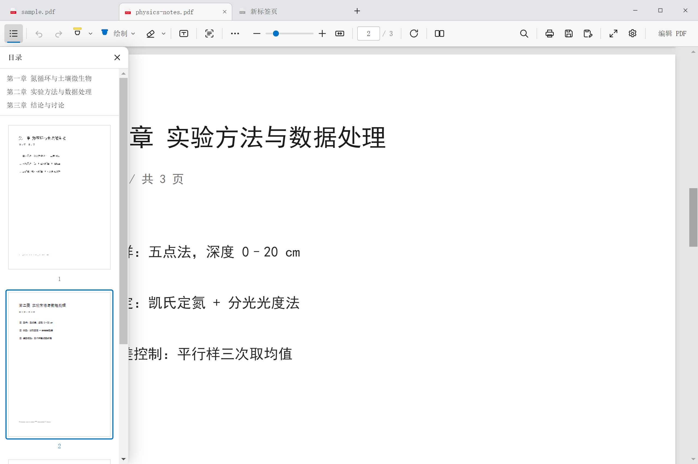

# 多标签页与目录侧栏：交互说明

本文说明两块界面：**顶部标签条**（浏览器式多标签页，可拖出为独立窗口）与
**左上角汉堡按钮展开的「目录」侧栏**。



---

## 一、界面分区

窗口从上到下分成四层，阅读区始终是最大的那一块：

| 层 | 高度 | 内容 | 说明 |
| --- | --- | --- | --- |
| ① 标签条 `#tabbar` | 38px | 标签页 + `+` + 窗口按钮 | 兼作标题栏（无边框窗口），拖动空白处移动窗口、双击最大化 |
| ② 工具栏 `#toolbar` | 48px | 单层工具栏，全部功能一行放下 | 不因标签页数量变化 |
| ③ 内容区 `#main` | 自适应 | 页面区（目录侧栏是浮层） | 侧栏默认收起，展开时 236px 浮在页面之上 |
| ④ 浮层 | — | 搜索条、OCR 面板、弹窗、拖拽浮影 | 不参与布局 |

### 标签页（关键元素）

```
┌─────────────────────────────────────────────┐
│ ▢ sample.pdf  ×  ▢ physics-notes.pdf  ×   ＋ │  ← 标签条
├─────────────────────────────────────────────┤
│ ☰ ↶ ↷ ▮ 绘制 ⌄ ⌫ …                          │  ← 工具栏（保持不变）
```

- **图标**：每个标签左侧是 **PDF 文件图标**（与资源管理器里 `.pdf` 的图标同一份资源），
  空白标签页显示为灰度图标；
- **标题**：文件名（不是完整路径），过长时省略号截断，完整路径在 `title` 提示里；
- **关闭按钮**：悬停或选中时出现 `×`；**有未保存修改时 `×` 变成一个圆点**，鼠标移上去才恢复成 `×`；
- **选中态**：白底 + 三边 1px 描边 + 顶部圆角 8px，与下方工具栏同色，视觉上"连着"；
- **`+`**：紧跟在最后一个标签后面，点击新建空白标签页（空状态页里可直接选文件）；
- **溢出**：标签固定 208px 宽，超出窗口时标签条横向滚动（滚轮可滚），右端渐隐提示还有更多；
- **插入指示**：拖动排序时在落点处显示 2px 蓝色竖线；
- **窗口按钮**：最右侧 3 × 46px 的最小化 / 最大化（还原）/ 关闭，关闭键悬停变红；
- **宽度自适应**：标签放得下时固定 208px；放不下就按数量均分收窄，最少 72px
  （此时隐藏关闭按钮），仍放不下才横向滚动，并自动把当前标签滚入可见区。

### 目录侧栏（关键元素）


- **入口**：左上角 `☰`（汉堡）按钮，点击展开/收起，按钮本身有选中态；
- **标题行**：左侧「目录」，右侧 `×` 关闭；
- **书签区**：PDF 自带的大纲（`/Outlines`），按层级缩进，点击跳到对应页；文档没有书签时整块隐藏；
- **缩略图区**：每页一张缩略图，下方是页码；**当前页用 2px 蓝色描边**标记，
  滚动正文时高亮跟着走，缩略图列表会自动把它滚到视野中间；
- 侧栏只在有文档时可展开（空白标签页点 `☰` 会提示"请先打开 PDF 文件"）。

---

## 二、整体交互流程

### 1. 打开文档 → 落在哪个标签页

```
用户操作                     行为
─────────────────────────────────────────────────────────────
Ctrl+O / 拖入文件 / 双击 .pdf
   ├─ 该文件已在某个标签页打开  → 直接切到那个标签页（不再新建）
   ├─ 当前标签页是空白页        → 复用这个空白页
   └─ 其它情况                  → 新建标签页并激活
```

- 打开期间会显示加载浮层，此时**切换标签页的请求会排队**，等文档加载完再执行，
  避免"页面画到一半被换走"的错位；
- 双击 `.pdf` 启动程序时，文件落在第一个标签页；程序已在运行时再双击，会作为**新标签页**加入现有窗口。

### 2. 切换标签页

点击标签 → 立即切换（按下即生效，符合浏览器习惯）：

1. 隐藏旧标签页的视图（`display:none`，DOM 与画布都保留，不销毁）；
2. 显示新标签页的视图，把渲染器绑定到它的滚动容器；
3. 同步工具栏状态：页码、总页数、缩放、当前工具、编辑条显隐、撤销/重做可用性；
4. 恢复该标签页自己的搜索条与 OCR 结果列表；
5. 对可视区域做一次懒渲染补绘（缩放没变时直接复用已有画布，不会闪白）。

**每个标签页各自独立的状态**：`filePath` / `pdfDoc` / 页面模型 / 标注 / 撤销栈 / 缩放 /
当前页 / 工具与颜色 / 搜索结果 / OCR 结果 / 未保存标记。

### 3. 拖动标签：排序 or 拖出

按下标签后移动超过 6px 进入拖拽：

```
                    ┌── 松手时仍在标签条内 ──→ 按落点位置重新排序（蓝色竖线指示）
按下 → 拖动 → 松手 ┤
                    └── 松手时落在标签条外 ──→ 拖出为独立窗口
```

拖出时的视觉反馈：原标签半透明（`opacity:.4`），光标下方跟一个**标签浮影**，
浮影在标签条外会加**蓝色虚线描边**，表示"松手就在新窗口打开"。

**只有一个标签、且只有一个窗口时**，标签条就是标题栏：拖动标签等于拖动窗口（窗口跟着走），
不会弹出新窗口、也不会留下空白页。

**松手落在另一个窗口上**：标签会合并到那个窗口（"放回去"）；如果源窗口因此变空，源窗口自动关闭。
落在空白桌面才会新建窗口。

拖出的实现与约束：

- 渲染进程把 `{ 路径, 页码 }` 交给主进程，主进程在**鼠标位置**新建窗口（按屏幕可用区域夹取坐标），
  新窗口把该文件作为自己的第一个标签页打开，并跳到原页码；
- 原窗口的标签页随即关闭，文档"搬"过去了；
- **有未保存修改时不允许拖出**（会提示先保存），因为新窗口是重新从磁盘读文件，
  内存里的标注不会跟过去；空白标签页同理（还没有文件）。
- 只有一个标签的窗口把标签拖到空白处不会做任何事（提示"松手位置没有其他窗口"），
  避免出现两个只含同一文件的窗口。

### 4. 关闭标签页

| 触发 | 行为 |
| --- | --- |
| `×` / 中键 / `Ctrl+W` | 关闭当前标签页 |
| 右键 → 关闭其他 / 关闭右侧 | 批量关闭（有未保存修改的会跳过并保留） |
| 关掉最后一个标签页 | 自动补一个空白标签页，窗口不关闭 |

关闭有未保存修改的标签页时弹出三选一：**取消 / 不保存并关闭 / 保存并关闭**
（保存并关闭会先把该标签页切到前台再走正常的保存流程）。

### 5. 关闭窗口

关闭窗口时检查**所有**标签页：都不脏就直接关；只有一个脏且就是当前页，弹"保存更改？"；
多个脏则列出文件名，提供"不保存并关闭"。

### 6. 目录侧栏

`☰` → 侧栏从左滑出，**浮在页面上方**（绝对定位，不改变页面区宽度，因此不会推挤或重排文档，
"适应宽度"的缩放也保持不变），右侧带投影以便与页面区分；
点击书签跳章 → 正文滚动、缩略图高亮与页码输入框同步；
点击缩略图 → 跳到该页；`×` 或再次点 `☰` 收起。
展开动画为「先加速 → 到位减速 → 回弹再加速」，与工具栏下拉菜单一致。

---

## 三、与浏览器的差异（有意为之）

| 项 | 浏览器 | 本项目 | 原因 |
| --- | --- | --- | --- |
| 新标签页内容 | 空白页 / 起始页 | 空白页 + "打开 PDF 文件"按钮 | 阅读器没有"主页"概念 |
| 标签图标 | 网站 favicon | 统一 PDF 图标（空白页为灰度） | 都是本地文件，没有 favicon |
| 关闭最后一个标签 | 关闭窗口 | 保留窗口 + 空白标签页 | 避免与"未保存确认"叠加造成误关 |
| 拖出标签 | 连同会话一起搬走 | 重新打开文件、跳到原页码 | 标注在内存里，未保存不搬 |

---

## 四、实现位置（给贡献者）

| 文件 | 职责 |
| --- | --- |
| `src/renderer/js/tabs.js` | 标签页模型、标签条渲染、切换、关闭、拖拽排序、拖出、右键菜单 |
| `src/renderer/js/state.js` | `createDocState()`：一个标签页一份文档状态 |
| `src/renderer/js/viewer.js` | `createView / bindTab / destroyView`：每个标签页一套滚动区与页面容器；目录（书签 + 缩略图） |
| `src/renderer/js/ui.js` | `syncTabUI()` 把标签页状态同步到工具栏；`☰` 展开侧栏；快捷键 |
| `src/main/main.js` | 多窗口管理（`windows` 集合）、`tab:detach` 在新窗口打开、按窗口的关闭确认 |
| `src/main/preload.js` | `detachTab` 桥接 |

自检：`npm run test:tabs`（标签页去重 / 排序 / 拖出 / 关闭 / 状态隔离）。
